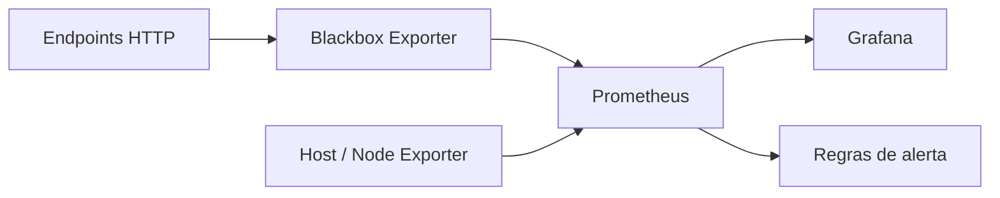

# Vigia Infra

Laboratório de observabilidade para praticar monitoramento de endpoints HTTP e métricas de host com Prometheus, Grafana, Blackbox Exporter, Node Exporter e Docker Compose. O projeto reúne configuração versionada, dashboard provisionado, regras de alerta, validação automatizada e um runbook de triagem.

> **Escopo:** este repositório demonstra uma stack local de laboratório. Não é uma plataforma de monitoramento pronta para produção.

## Problema

Em um ambiente pequeno, perceber que um endpoint deixou de responder ou ficou lento pode depender de verificações manuais. O Vigia Infra organiza uma forma reproduzível de observar disponibilidade e latência de alguns endpoints, acompanhar métricas do host e consultar os sinais em um dashboard.

Os alvos HTTP incluídos são exemplos públicos (https://github.com e https://prometheus.io). Eles servem para demonstrar a configuração e devem ser substituídos por serviços que você tem autorização para monitorar.

## Arquitetura

Os serviços são definidos em **docker-compose.yml** e se comunicam pela rede Docker **vigia-monitoring**. Prometheus coleta as métricas, avalia as regras de alerta e fornece a fonte de dados consultada pelo Grafana.



| Componente | Papel neste laboratório |
| --- | --- |
| **Prometheus** | Coleta métricas a cada 30 segundos, armazena séries localmente com retenção configurada de 15 dias e avalia as regras. |
| **Blackbox Exporter** | Executa sondagens HTTP usando o módulo **http_2xx** e expõe o resultado para o Prometheus. |
| **Node Exporter** | Expõe métricas de CPU, memória, disco e rede do host acessível ao container. |
| **Grafana** | Consulta o Prometheus e carrega o dashboard versionado por provisionamento. |
| **Docker Compose** | Declara os serviços, volumes locais, mounts de configuração e a rede interna do laboratório. |

No Docker Desktop, os dados apresentados pelo Node Exporter podem refletir a VM Linux usada pelo Docker, em vez do sistema operacional hospedeiro diretamente.

## Fluxo de monitoramento

1. Prometheus agenda a coleta dos próprios dados, do Node Exporter e do endpoint de sondagem do Blackbox Exporter.
2. Para cada URL configurada em **prometheus/prometheus.yml**, Prometheus envia o alvo ao Blackbox Exporter através de **/probe**.
3. O Blackbox Exporter faz a requisição HTTP e retorna sinais como **probe_success** e **probe_duration_seconds**.
4. Prometheus armazena os resultados e avalia as regras em **prometheus/rules/availability.yml**.
5. Grafana consulta Prometheus para apresentar os dados no dashboard **Vigia Infra**. A triagem pode ser feita também pelas consultas e telas do Prometheus.

As regras configuradas são:

| Regra | Condição | Aguardar |
| --- | --- | --- |
| **EndpointIndisponivel** | **probe_success == 0** | 2 minutos |
| **LatenciaHTTPAlta** | **probe_duration_seconds > 2** segundos | 5 minutos |
| **ColetorSemDados** | **up{job="node-exporter"} == 0** | 2 minutos |

As regras são avaliadas e ficam disponíveis no Prometheus. O repositório **não configura entrega de notificações externas**.

## Executar localmente

### Requisitos

- Docker Engine com Docker Compose v2
- Acesso à internet para baixar as imagens e sondar os alvos de exemplo

### Inicialização

1. Clone o repositório e acesse a pasta:

   ```bash
   git clone https://github.com/Gabrielaffonsocunha/vigia-infra.git
   cd vigia-infra
   ```

2. Crie o arquivo local de ambiente a partir do exemplo e troque o valor por uma senha forte:

   ```bash
   cp .env.example .env
   ```

3. Inicie a stack:

   ```bash
   docker compose up -d
   ```

4. Acesse os serviços no próprio computador:

   - Grafana: [http://localhost:3000](http://localhost:3000) — usuário **admin** e senha definida em **.env**
   - Prometheus: [http://localhost:9090](http://localhost:9090)
   - Blackbox Exporter: [http://localhost:9115](http://localhost:9115)

Para conferir o estado dos containers, use **docker compose ps**. A sondagem manual descrita no [runbook](docs/runbook.md) permite inspecionar uma URL de teste.

### Encerramento e dados

**docker compose down** para os containers e mantém os volumes nomeados. **docker compose down -v** também remove os volumes locais do Prometheus e do Grafana, apagando os dados persistidos.

## Testes e validação

O workflow [Validar laboratório](.github/workflows/validate.yml) roda em cada push e pull request. Ele verifica:

- a configuração renderizada do Compose com **docker compose config --quiet**;
- a configuração do Prometheus e as regras de alerta com **promtool check config** e **promtool check rules**;
- a sintaxe JSON do dashboard do Grafana com **python -m json.tool**.

Essas verificações detectam erros de configuração e formato. Elas **não iniciam a stack nem comprovam conectividade, comportamento de ponta a ponta, recuperação de falhas ou funcionamento de notificações**.

## Decisões de segurança

- As portas de Grafana, Prometheus e Blackbox Exporter são publicadas em **127.0.0.1**, limitando o acesso às interfaces no host local.
- O login anônimo e o cadastro aberto de usuários do Grafana estão desativados.
- A senha administrativa é configurável por variável de ambiente. O arquivo **.env** é local: não o publique nem mantenha o valor demonstrativo do **.env.example**.
- Os arquivos de configuração são montados como somente leitura; o Node Exporter também usa filesystem somente leitura e monta a raiz do host em modo somente leitura para consultar métricas.
- Os dados do Prometheus e do Grafana ficam em volumes Docker locais. O Prometheus está configurado para retenção de 15 dias.
- Os alvos padrão são externos e públicos. Antes de adicionar outros, confirme autorização, acessibilidade e se a sondagem não expõe dados ou serviços sensíveis.

Essas medidas reduzem exposição no cenário local; não substituem controles de produção. O projeto não configura TLS, alta disponibilidade (HA), backup e restauração, nem notificações externas. Não exponha os serviços diretamente à internet nem reutilize a configuração de laboratório como implantação de produção.

## Limitações conhecidas

- Instância única dos componentes, sem HA ou failover.
- Sem TLS ou proxy de acesso remoto; as interfaces são destinadas ao uso local.
- Sem backup automatizado ou teste de restauração dos volumes.
- Sem Alertmanager ou integração para envio de notificações externas.
- Retenção local fixa em 15 dias; não há armazenamento remoto de métricas.
- O Node Exporter depende das permissões e dos mounts do host; no Docker Desktop, a origem das métricas pode ser a VM Linux.
- As verificações de CI validam arquivos de configuração, mas não substituem testes de execução da stack.
- A coleta de cada alvo depende da conectividade e da resolução DNS disponíveis no host do laboratório.

## Próximos passos

Uma evolução realista pode seguir esta ordem:

1. **Ampliar a validação:** adicionar verificações automatizadas da configuração do Blackbox e testes de execução da stack em ambiente isolado.
2. **Adaptar os alvos e painéis:** documentar como adicionar serviços autorizados e evoluir o dashboard com indicadores que apoiem a triagem.
3. **Planejar notificações:** avaliar Alertmanager, canais apropriados e gestão segura de credenciais antes de implementar qualquer envio.
4. **Preparar acesso remoto seguro:** definir requisitos de autenticação, TLS, rede e exposição antes de publicar interfaces fora do host local.
5. **Tratar continuidade:** definir política de retenção, backup e procedimento de restauração; considerar HA apenas se houver requisitos que justifiquem a complexidade.

Esses itens são propostas de evolução e ainda não fazem parte do laboratório.

## Estrutura principal

- **docker-compose.yml**: serviços, portas, rede, volumes e mounts.
- **prometheus/prometheus.yml**: intervalo de coleta, jobs e alvos de exemplo.
- **prometheus/rules/availability.yml**: regras de alerta.
- **blackbox/blackbox.yml**: módulo de sondagem HTTP.
- **grafana/dashboards/vigia-infra.json**: dashboard versionado.
- **grafana/provisioning/**: provisionamento da fonte de dados e do dashboard.
- **docs/runbook.md**: roteiro para confirmar alertas, investigar sondagens e registrar recuperação.
- **.github/workflows/validate.yml**: validações executadas pelo GitHub Actions.

## Autor

**Gabriel Afonso** — Infraestrutura de TI, observabilidade e automação.
